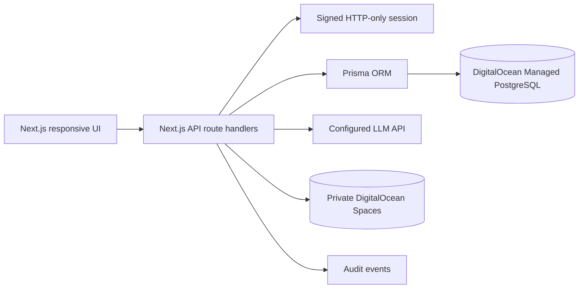

# MediLink AI architecture

## Trust boundaries

- The browser never receives database credentials, AI keys, or Spaces credentials.
- API handlers derive the user identity from the signed session cookie, not request payloads.
- Each private document query is scoped to the authenticated owner. Signed URLs expire after five minutes.
- Appointment uniqueness is enforced by a database constraint on provider and start time, with a server-side conflict check for a useful error.
- The AI system prompt is a safety layer, not a clinical guarantee. Emergency keyword escalation happens before the external call.

## Production hardening

Add a distributed rate limiter, CSP/security headers, structured redacted logs, an audit-event viewer restricted to administrators, malware scanning for uploads, document retention jobs, and a vetted medical knowledge retrieval layer with source citations.
